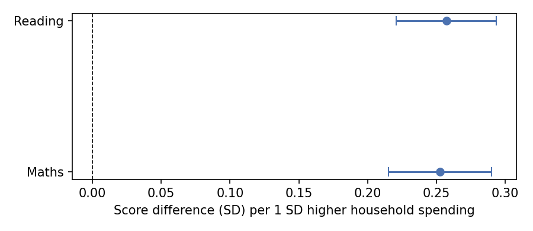

# Household Spending and Children's Learning in Northern India

An independent open-data analysis project (not a peer-reviewed publication), motivated by [Project Akshhar](https://akshhar.com), which works with government school teachers and students in northern India.

## Question
How strongly are reading and maths levels of children aged 8-11 in northern India related to their household's spending, and does this hold when comparing children within the same state?

**Note:** this describes associations only. These data cannot show that spending *causes* higher scores.

## Data
- **Source:** India Human Development Survey-II (IHDS-II), 2011-12, ICPSR 36151 (Desai and Vanneman). Free to download from ICPSR after creating an account: https://doi.org/10.3886/ICPSR36151.v6
- **Sample:** 5,593 children aged 8-11 in 744 villages and urban blocks across nine northern states and union territories (J&K, Himachal Pradesh, Punjab, Chandigarh, Uttarakhand, Haryana, Delhi, Rajasthan, Uttar Pradesh).
- **Tests:** reading level 0-4 (cannot read to story) and maths level 0-3 (cannot recognise numbers to division). 43.5% could read a story; 23.1% could do division.
- **Disadvantage measure:** household spending per person, log-transformed and standardised.
- The data files are **not** in this repo, because ICPSR's terms of use do not allow redistribution.

## What I did
1. Kept children aged 8-11 in the nine northern states. About 83% had test results.
2. Converted test levels and spending into z-scores, so gaps are in standard deviations (SD).
3. Split children into four equal groups by spending and compared the poorest and richest quarter, with a bootstrapped 95% confidence interval.
4. Ran regressions (standard errors clustered by village): A) spending only, B) plus sex, age and urban/rural, C) plus state.
5. Compared government and private school children, before and after adjusting for the same variables.

Full code: [IHDS_data.ipynb](IHDS_data.ipynb)

## Results

| Spending group | Children | Maths (SD) | Reading (SD) | % read a story | % do subtraction or better |
|---|---|---|---|---|---|
| Q1 poorest | 1,399 | -0.44 | -0.40 | 30.1 | 30.4 |
| Q2 | 1,397 | -0.15 | -0.10 | 38.8 | 42.3 |
| Q3 | 1,398 | 0.12 | 0.09 | 46.4 | 55.8 |
| Q4 richest | 1,398 | 0.47 | 0.40 | 58.8 | 71.9 |

- The richest quarter scored **0.92 SD higher in maths** (95% CI 0.84 to 0.99) and **0.80 SD higher in reading** (95% CI 0.72 to 0.87) than the poorest quarter.
- Within the same state, 1 SD higher household spending was associated with **0.25 SD higher maths** (95% CI 0.22 to 0.29) and **0.26 SD higher reading** (95% CI 0.22 to 0.29).
- That is about **10.5 percentage points** higher chance of reading a story and **11.1 points** higher chance of doing subtraction or better.
- Private-school children scored higher than government-school children (raw gap 0.45 SD in maths, 0.49 in reading). After adjusting for spending and the other variables the gap was 0.39 (maths) and 0.42 (reading).

**Reading the results:** Household spending is clearly associated with children's reading and maths levels. The pattern is steady across spending groups and remains after comparing children within the same state. This is an association only. It does not show that spending itself raises test scores, and it points to other factors that may sit between household income and a child's learning, or may be behind both.

### Factors I think matter most (not tested in this analysis)
- **Parents' education.** It may influence both a household's income and what a child learns at home, so it could partly explain the link I found. IHDS records the highest education among adults in each household, which could serve as an approximate measure in a next version. It is not specifically the parents' education.
- **Parenting.** How parents support learning, such as routines, warmth and involvement, may be one pathway through which financial strain affects children. IHDS does not measure this.
- **Coping mechanisms.** How families and children deal with financial and other stress may be another pathway. IHDS does not measure this either.

Frameworks such as the family stress model suggest that economic strain can affect parents' wellbeing and parenting, which in turn shapes children's development. I treat this as a hypothesis consistent with earlier research, not something my analysis demonstrates.

Studying parenting and coping would need data or a study design that measures them directly. This is the direction I would like to pursue in graduate study.

## Limitations
- Observational data from one point in time: associations, not causes.
- Data are from 2011-12.
- Test scores are coarse ordered levels, not marks.
- About 17% of children have no test result.
- Survey weights were not applied, so results describe this sample, not all northern India.
- Uttar Pradesh and Rajasthan make up over half the sample.
- Parents' education, parenting and coping are not included in the models.
- The private-school gap does not show that private schools cause better learning. Families who choose private schools may differ in ways not measured here.

## Next steps
- Add household adult education (`HHEDUC`) to the models and see how much of the spending gap remains.
- Apply the survey weights and break results down by caste group.

**Reading the results:** Household spending is clearly associated with children's reading and maths levels. The pattern is steady across spending groups and remains after comparing children within the same state. This is an association only. It does not show that spending itself raises test scores, and it points to other factors that may sit between household income and a child's learning, or may be behind both.

### Factors I think matter most (not tested in this analysis)
- **Parents' education.** It may influence both a household's income and what a child learns at home, so it could partly explain the link I found. IHDS records the highest education among adults in each household, which could serve as an approximate measure in a next version. It is not specifically the parents' education.
- **Parenting.** How parents support learning, such as routines, warmth and involvement, may be one pathway through which financial strain affects children. IHDS does not measure this.
- **Coping mechanisms.** How families and children deal with financial and other stress may be another pathway. IHDS does not measure this either.

Frameworks such as the family stress model suggest that economic strain can affect parents' wellbeing and parenting, which in turn shapes children's development. I treat this as a hypothesis consistent with earlier research, not something my analysis demonstrates.

Studying parenting and coping would need data or a study design that measures them directly. This is the direction I would like to pursue in graduate study.
